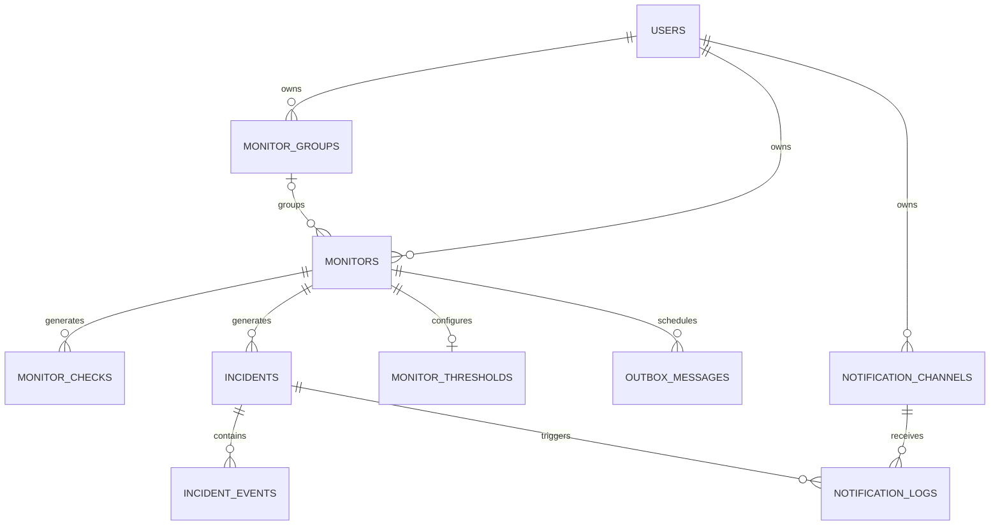

# PulseWatch | Database Documentation

**Documento:** Database Design and Data Model  
**Versão:** 1.0  
**Status:** Proposta aprovada para o MVP  
**Banco de dados:** PostgreSQL  
**ORM:** Laravel Eloquent  
**Data:** 17/11/2026

---

## 1. Introdução

Este documento descreve a estrutura de dados do PulseWatch, incluindo entidades, relacionamentos, atributos, restrições de integridade, índices e estratégias de persistência.

O PostgreSQL será utilizado como banco de dados principal da plataforma.

O Laravel será responsável pela persistência e gerenciamento dos dados de negócio. O Monitoring Engine desenvolvido em Python não realizará escritas diretamente nas tabelas da aplicação.

A comunicação entre Laravel e Python ocorrerá por meio do RabbitMQ, utilizando contratos de mensagens versionados.

## 2. Objetivos da modelagem

- Garantir integridade e consistência dos dados.
- Suportar histórico de verificações de monitoramento.
- Permitir consultas eficientes de disponibilidade.
- Gerenciar incidentes e seus eventos.
- Armazenar configurações de notificações.
- Suportar processamento assíncrono.
- Preparar a estrutura para crescimento do volume de dados.
- Permitir evolução futura para multi-tenancy.

## 3. Tecnologias

| Tecnologia | Responsabilidade |
|---|---|
| PostgreSQL | Banco relacional |
| Laravel Eloquent | ORM |
| Laravel Migrations | Versionamento do schema |
| UUID | Identificação das entidades |
| JSONB | Dados semiestruturados |
| Redis | Cache e locks |
| RabbitMQ | Comunicação assíncrona |

## 4. Convenções

### 4.1. Nomenclatura

- Tabelas no plural.
- Nomes em snake_case.
- Colunas em snake_case.
- Chaves primárias denominadas id.
- Chaves estrangeiras no padrão entidade_id.
- Timestamps em UTC.
- Identificadores UUID.

### 4.2. Tipos de dados

| Tipo PostgreSQL | Utilização |
|---|---|
| UUID | Identificadores |
| VARCHAR | Textos com tamanho definido |
| TEXT | Textos extensos |
| INTEGER | Contadores e intervalos |
| SMALLINT | Códigos HTTP |
| BOOLEAN | Indicadores |
| TIMESTAMPTZ | Datas e horários |
| JSONB | Dados estruturados variáveis |
| SMALLINT[] | Códigos HTTP esperados |

### 4.3. Identificadores

As entidades principais utilizarão UUID como chave primária.

A geração dos UUIDs será realizada pela aplicação, utilizando UUID v7 quando suportado pela implementação escolhida.

### 4.4. Exclusão lógica

As entidades que necessitarem de recuperação ou preservação operacional poderão utilizar soft deletes.

O histórico de verificações e incidentes não deverá ser removido automaticamente quando um monitor for excluído.

## 5. Modelo entidade-relacionamento

A relação entre monitores e mensagens Outbox é lógica, por meio de aggregate_type e aggregate_id, não uma chave estrangeira obrigatória.

## 6. Entidades

### 6.1. users

Armazena os usuários da plataforma.

| Campo | Tipo | Restrições |
|---|---|---|
| id | UUID | PK |
| name | VARCHAR(150) | NOT NULL |
| email | VARCHAR(255) | UNIQUE, NOT NULL |
| password | VARCHAR(255) | NOT NULL |
| email_verified_at | TIMESTAMPTZ | NULL |
| remember_token | VARCHAR(100) | NULL |
| created_at | TIMESTAMPTZ | NOT NULL |
| updated_at | TIMESTAMPTZ | NOT NULL |

### 6.2. monitor_groups

Permite organizar monitores por aplicação, ambiente ou finalidade.

| Campo | Tipo | Restrições |
|---|---|---|
| id | UUID | PK |
| user_id | UUID | FK, NOT NULL |
| name | VARCHAR(100) | NOT NULL |
| description | TEXT | NULL |
| created_at | TIMESTAMPTZ | NOT NULL |
| updated_at | TIMESTAMPTZ | NOT NULL |

### 6.3. monitors

Armazena os serviços e endpoints monitorados.

| Campo | Tipo | Restrições |
|---|---|---|
| id | UUID | PK |
| user_id | UUID | FK, NOT NULL |
| group_id | UUID | FK, NULL |
| name | VARCHAR(150) | NOT NULL |
| description | TEXT | NULL |
| url | TEXT | NOT NULL |
| method | VARCHAR(10) | NOT NULL |
| headers | JSONB | NULL |
| request_body | JSONB | NULL |
| expected_status_codes | SMALLINT[] | NOT NULL |
| status | VARCHAR(20) | NOT NULL |
| current_state | VARCHAR(20) | NOT NULL |
| interval_seconds | INTEGER | NOT NULL |
| timeout_ms | INTEGER | NOT NULL |
| next_check_at | TIMESTAMPTZ | NULL |
| last